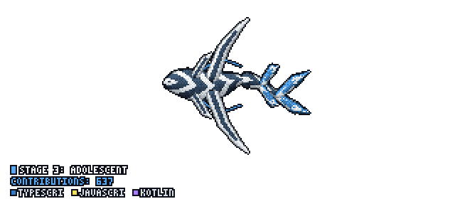

# Hey, I'm Nox 👋

  

**Full-stack Developer | Python & JavaScript | Open-source Enthusiast**

I love building clean, efficient, and impactful projects. Currently exploring **web development, automation, and open-source contributions**.

---

## 🔭 My Top Projects

- 🎵 **[Resonix](https://github.com/Nox-Wizard-py/Resonix)** – Personalised YouTube Music client with Material 3 design & infinite customizations | `Kotlin, Jetpack Compose`
- 🌐 **[Musical Chair Audio Player](https://github.com/Nox-Wizard-py/Musical-Chair)** – Completely Unbiased Music Player for the Musical Chairs Game | `HTML, JavaScript`
- 🔊 **[BeatSync](https://github.com/Nox-Wizard-py/beatsync.gg)** – High-precision multi-device audio playback & spatial audio | `TypeScript`
- 🍽️ **[Restaurant Landing Page](https://github.com/Nox-Wizard-py/Restaurant-Landing-Page)** – Modern restaurant landing page | `React, Vite, Tailwind CSS`

---

## 💻 Techs I Mastered

---

## 📈 GitHub Stats

<!-- GitHub General Stats (via Statically / Anurag's reliable fallback endpoint) -->

  

<!-- Working Streak Stats -->

  

<!-- Galaga animation -->

  <picture>
    <source
      media="(prefers-color-scheme: dark)"
      srcset="https://raw.githubusercontent.com/Nox-Wizard-py/Nox-Wizard-py/output/galaga-contribution-graph-dark.svg"
    />
    <source
      media="(prefers-color-scheme: light)"
      srcset="https://raw.githubusercontent.com/Nox-Wizard-py/Nox-Wizard-py/output/galaga-contribution-graph.svg"
    />
    
  </picture>

<!-- Tulkun Animation -->

  

---

## 📫 Connect with Me

- [LinkedIn](https://www.linkedin.com/in/nazmul-hossain-10b335341/)
- [Twitter / X](https://x.com/Nox_Wizard_py)
- [Telegram](https://t.me/offxe_shoyo)
- [Email](mailto:hossainazmul132@gmail.com)

---

### ⚡ Fun Fact

🏏 I'm a cricket enthusiast and love building projects that make life easier!

  

